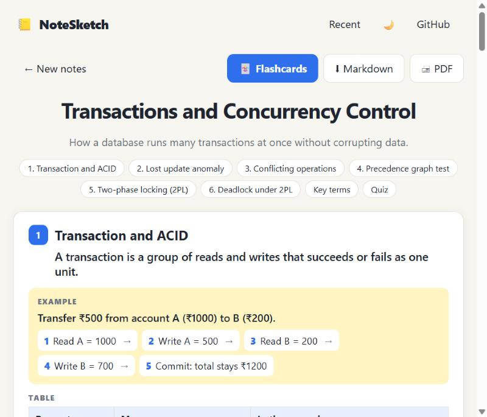
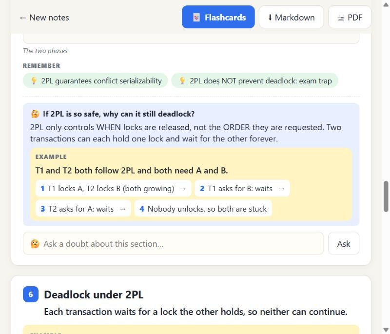
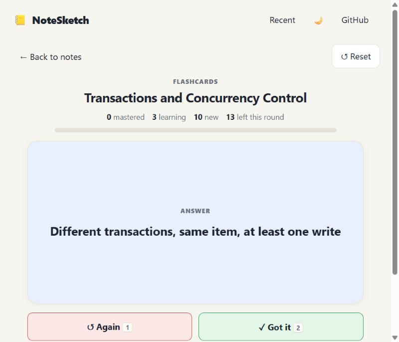
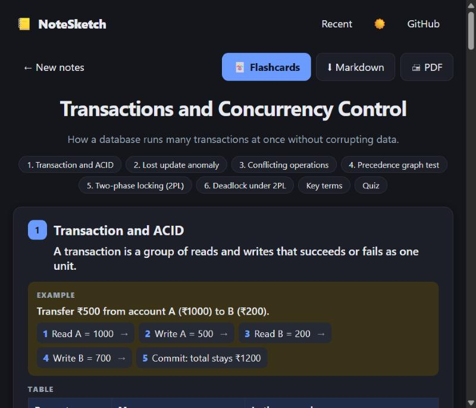

# 📒 NoteSketch

**Lectures in. Examples, tables & diagrams out, in your own language.**

**▶ Live demo: https://nethra-r368.github.io/h/** (click **See an example** to try it with no API key)

Upload a lecture PDF (or paste text) and NoteSketch rewrites it as study notes for students who don't learn well from walls of text: every idea becomes a worked example with real numbers, a timeline table or a diagram. Then you can ask doubts, drill flashcards and export.



## Features

| Feature | What it does |
|---|---|
| ✏️ Example-first notes | Each concept: one-line idea → worked example with real values → table and/or diagram → "remember" exam traps |
| 📊 Timeline & comparison tables | e.g. reads and writes of T1, T2 over time |
| 🔀 Diagrams (Mermaid) | flows, cycles, sequences; falls back to readable text if the AI draws an invalid one |
| 🌏 **Notes in 5 languages** | English, தமிழ் Tamil, हिन्दी Hindi, తెలుగు Telugu, മലയാളം Malayalam. Technical terms stay in English in brackets, e.g. *பரிவர்த்தனை (Transaction)*, so the notes still match the exam paper |
| 🤔 **Ask a doubt** on any section | Type a question under a card; Gemini gets that section's JSON + your question and answers in ≤50 words **plus a tiny worked example**. Answers stay on the card, in history and in the Markdown export |
| 🃏 **Flashcards** | Built from key terms + quiz. Flip, then "Got it" / "Again". Leitner boxes: "Again" comes back 3 cards later, a card is mastered after 3 "Got it"s. Progress saved per lecture on your device. Keyboard: Space / 1 / 2 |
| ❓ Quiz | 5 clickable questions with instant feedback and reasons |
| ⬇ Export | Markdown (diagrams included; works in GitHub/Obsidian/Notion) or PDF (print styles) |
| 🌗 Dark mode | Follows your system (`prefers-color-scheme`), with a manual toggle; diagrams re-render in the matching theme |
| 📱 Mobile-first | Works at 375px wide with no horizontal scroll |
| ⏳ Loading skeleton | Shimmering preview with live progress steps and a Cancel button while Gemini works |
| 🕘 Recent notes | Last 5 notes (with your doubts) kept in your browser |

| Ask a doubt | Flashcards | Dark mode |
|---|---|---|
|  |  |  |

More screenshots are in [`docs/screenshots/`](docs/screenshots/).

## Run it

It is a static site with no build step and no server.

```bash
python -m http.server 8000      # then open http://localhost:8000
```

Get a free Gemini API key at https://aistudio.google.com/apikey and paste it under "🔑 Gemini API key".
The default model is `gemini-3.8-flash`. If it is busy or retired, NoteSketch automatically tries other current Flash models.

## How it works

```
PDF ──pdf.js──► text ──► buildPrompt (example-first, ≤25 words, tables, Mermaid, + language rule)
                              │
                              ▼
                 Gemini (JSON mode, called straight from the browser)
                              │
                              ▼
     extractJson → normalizeNotes (repairs bad AI output) → render cards ─► Mermaid diagrams
                                                                │
              ┌─────────────────────────────┬───────────────────┴──────────────┐
              ▼                             ▼                                  ▼
  Ask a doubt: buildDoubtPrompt     Flashcards: buildDeck →            Export: toMarkdown / print
  (section JSON + question) →       startQueue / reviewCard            
  Gemini → normalizeDoubt           (Leitner) → localStorage
```

Privacy: the lecture goes straight from your browser to Google's Gemini API. There is no NoteSketch server. The API key is only saved if you tick "Remember", and it is never in this repo.

More detail for judges: [docs/HOW_IT_WORKS.md](docs/HOW_IT_WORKS.md).

## Tests

```bash
node --test test/core.test.mjs
```

15 unit tests cover the prompt (including every language), JSON extraction and repair, the doubt prompt and answer repair, the flashcard deck and Leitner scheduling, saved-progress parsing and the Markdown export.

## Files

```
index.html          page
css/style.css       styles: light/dark tokens, mobile, skeleton, flashcards, print
js/app.js           UI, PDF reading, Gemini calls, rendering, doubts, flashcards, history
js/core.js          pure logic, no DOM (prompts, JSON repair, languages, Leitner, markdown), unit-tested
js/sample.js        built-in example (DBMS transactions)
test/               unit tests
docs/               how it works, submission text, demo script, screenshots
```

Built with: JavaScript, pdf.js, Mermaid, Google Gemini API, GitHub Pages. License: MIT.
